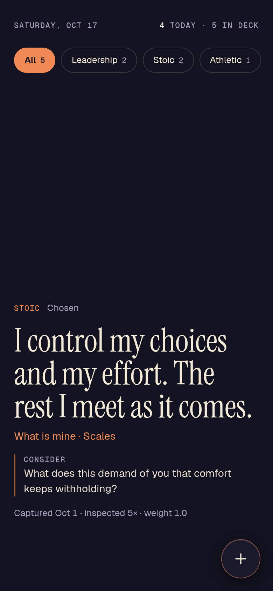
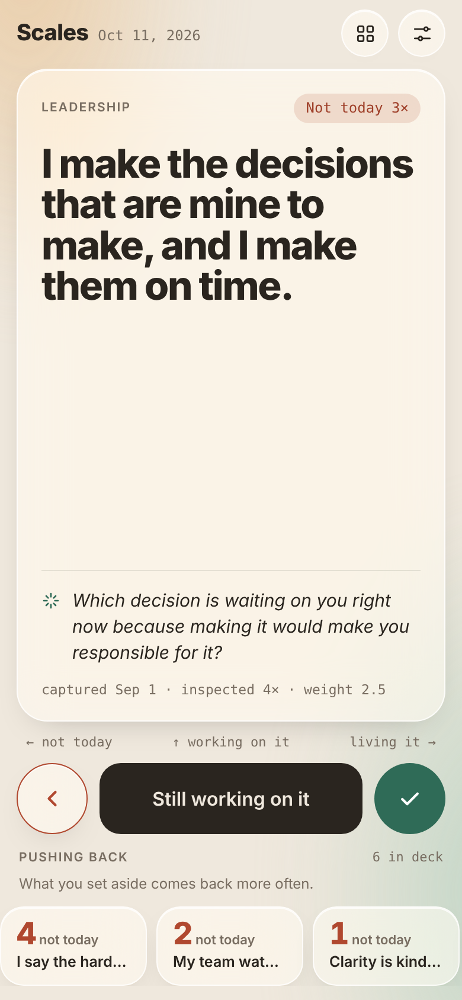

# Scales

A small phone app for testing your own thoughts.

You write down a thought you suspect is true ("the hard conversation is usually shorter than the dread before it"). Scales keeps putting it in front of you. Each time, you either reflect on it, skip it, or decide it has become part of how you act. When you live it without being reminded, you shed it, and it leaves the deck.

The name comes from scales falling from the eyes, and from Nietzsche's three metamorphoses: the camel carries ideas, the lion tests them, the child acts from them without thinking. Scales is built for the lion stage.

<p>
  
  
  
</p>

## How it works

**The deck.** One thought on screen at a time. Three moves:

| Move | Gesture | What happens |
|---|---|---|
| Skip | swipe left | Skip count goes up by 1. The thought comes back more often. |
| Reflect, keep it | swipe up | Counts as an inspection. If you stayed on the card at least 8 seconds, skip count drops by 1. |
| Shed | swipe right | Opens a short form for what showed you it is now true for you, then retires the thought. |

**Weighting.** A thought's chance of showing up is `1 + 0.5 x skips`, capped at 4x. The ones you avoid come back the most, which is the point. A short cooldown keeps the same thought from repeating back to back.

**Pushing back.** The strip under the buttons shows the thoughts you skip most, so resistance is visible instead of hidden.

**The ledger.** Shed count, share of the deck shed and resisting, average days to shed, each thought's history, and a 12 week activity grid.

**The line under each thought.** A short encouraging line, 15 words or fewer, matched to how often the thought has been skipped. Built-in lines are used by default. If you add your own Anthropic API key in Settings, the line is written fresh each time by a small, fast model. Only the thought text, skip count and days in the deck are sent.

## Privacy

- Everything lives in the phone's browser storage. No account, no server, no analytics.
- The API key, if used, stays on the phone and is sent only to `api.anthropic.com`.
- CSV and JSON files are ignored by git (`.gitignore`) so a personal export never ends up in this repo.

## Install on an iPhone

1. Open `https://grahamdeno.github.io/scales/` in Safari.
2. Share > Add to Home Screen.
3. Open it from the home screen icon. It runs full screen and works offline.

Optional: Settings (slider icon) > AI line > paste an Anthropic API key > Save key. Set a monthly spend limit in the Anthropic Console.

## Your data

- **Back up / Restore** (Settings): a JSON file of the whole deck. Keep it in iCloud Drive. Restore merges, it does not overwrite.
- **Import / Export CSV** (Settings): columns `text,title,author,creationDate,tags,collection,link,citation`, which matches common highlight and quote exports. Export adds `scales_*` columns (status, skips, reflects, shed date, evidence) so a re-import keeps progress. Import skips thoughts already in the deck.
- Deleting the home screen icon deletes the data. Back up first.

## Themes

Six themes: Auto (follows the phone's light or dark setting), Moss, Linen, Ink, Dusk and Return. Return is drawn from the Scales icon. Each theme is a set of CSS custom properties, so adding one means adding one block of color values and one entry in the theme list.

## Project layout

```
index.html              the whole app: markup, styles, script
sw.js                   service worker: offline shell, network first
manifest.webmanifest    home screen name, colors, icons
icons/                  app icon, maskable icon, favicons, source SVG
docs/                   architecture diagrams and screenshots
```

See [docs/ARCHITECTURE.md](docs/ARCHITECTURE.md) for diagrams of how the pieces fit, how a thought moves from capture to shed, and what happens each time a card is shown.

No build step and no dependencies. The only outside requests are Google Fonts and, if a key is set, the Anthropic API.

## Design decisions

- **One file.** Easy to read, easy to host on GitHub Pages, nothing to install.
- **Network first service worker.** Updates show up the next time the app opens; the cache only covers being offline. API calls are never cached.
- **Built-in lines first.** The app is fully usable with no key and no connection. The model line replaces the built-in one only if it comes back valid (15 words or fewer, does not just repeat the thought).
- **Skip cap at 4x.** Without a cap, one avoided thought would take over the deck.
- **Dwell check on reflect.** A quick swipe up should not erase a skip. Eight seconds on the card is the bar.

## Run it locally

```sh
python3 -m http.server 8000
```

Then open `http://localhost:8000`. The service worker needs `localhost` or HTTPS.

## Updating the live app

Push to `main`. GitHub Pages redeploys in about a minute. When cached files change, bump `CACHE` in `sw.js` (for example `scales-v9`) so phones drop the old copy.

## Roadmap

- iOS home screen widget showing the current thought
- Action Button shortcut for skip and reflect
- Whoop recovery as context for when to show the harder thoughts (kept on device, never sent to the model)

## License

MIT. See [LICENSE](LICENSE).
