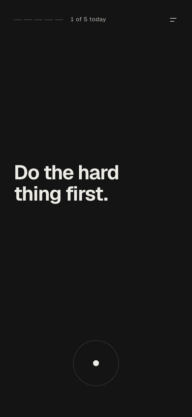
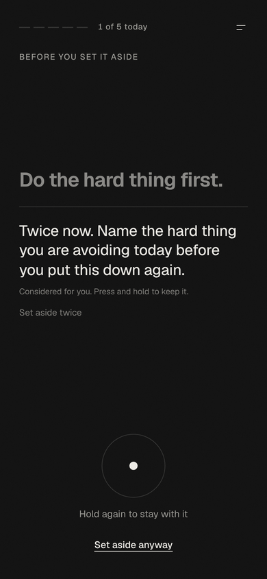
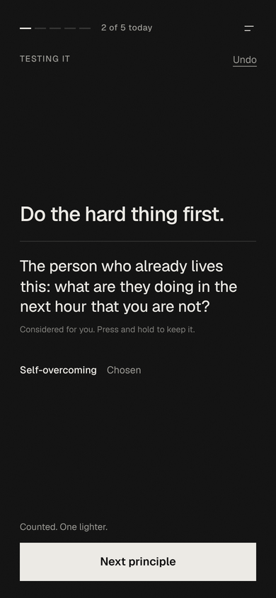
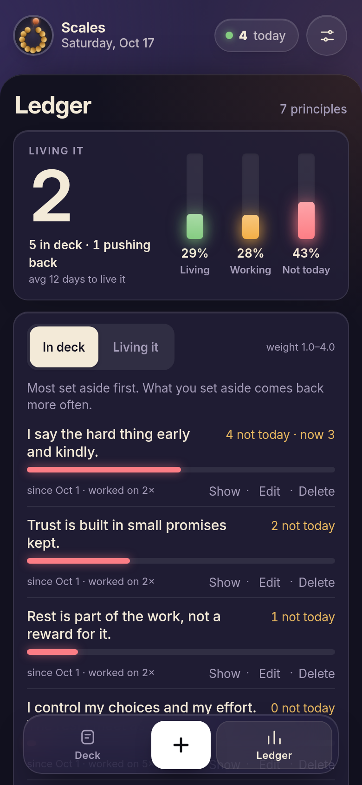

# Scales: Weigh your thoughts

A small phone app for weighing the thoughts you collect until they become how you actually live.

You write down a thought you want to live by ("the hard conversation is usually shorter than the dread before it"), or load a starter deck. Scales keeps putting it in front of you. Each time, you choose Skip, Reflect or Lived. Once you act on it without being reminded, it moves to your Lived record with a line on where it showed up.

<p>
  
  
  
  
</p>

## How it works

**Writing.** Capture and Edit open on matte paper with black lettering (on the White look, the reverse), so writing reads as a different mode from the deck. Cancel is on the left and Add or Save on the right; the keyboard comes up with the sheet. Capture is one field: where it came from, collection, title and author are under More details, and the character count shows only near the 1,500 limit.

**First run.** A new deck opens on a short welcome: what Scales is, a starter deck or one thought of your own, then the three choices, explained once. The + next to the menu captures a thought anytime.

**The deck.** At rest the screen holds one thought, a Today's question button and the three choices at the bottom: Skip, Reflect (in blue, the one Scales suggests) and Lived (1.73.0). Until 1.72 the choices hid behind a press and hold; they are always in view now. There is no date and no progress bar. Messages sit at the bottom of the screen, near your thumb.

| Move | Choose | What happens |
|---|---|---|
| Skip | from the choices | Scales pushes back once with a plain line, and offers Later. Skip it rests the thought: its count goes up by 1, it rests, then comes back first and set heavier. |
| Reflect | from the choices | A real quote from today's voice (or a question to sit with when no quote fits), where the thought came from, and Reply. After 8 seconds the test counts against Skip (the count drops by 1) and Next thought appears. Nothing moves on by itself. |
| Lived | from the choices | Opens a short form for where it showed up, then moves the thought to your record. |

A quick tap on the ring does nothing, so a stray touch never rests a thought. The three moves are also buttons for VoiceOver and the keyboard, and the arrow keys (left, up, right). Everything else (Capture, Edit, Show, the Ledger, Collections, Settings) is in the menu at the top right. With a keyboard, N captures, E edits, L switches between the deck and the Ledger, M opens the menu, and comma opens Settings.

**The pushback and the quote.** When you choose Skip, one plain line pushes back, written by AI from the thought's own words and its record: nothing invented about your day, no metaphors. On Reflect, the screen shows a real quote from today's voice instead of anything written. Scales reads the sourced quotes on that thinker's Wikiquote page (leaving out the disputed and misattributed ones), narrows them to the twenty that share the most words with your thought, and the AI picks the one that speaks to it, or none. When none fits, nothing is shown. Without a key, the closest match is shown only if it is a clear one. Each quote shows its author and work, and links to its Wikiquote page (text CC BY-SA 4.0). Both are kept on the thought and reused until you reflect on it again or change its wording; a thought that reaches three Skip gets its pushback rewritten once. Each voice's quotes are kept on the phone for 30 days, and only the voice's name is sent to Wikiquote. Press and hold a line or quote to keep it as a thought of its own; a kept quote keeps its author and work.

**Reply to the line.** On the skip screen and the sit-with screen, tap Reply, or the line or quote itself, to answer it. A sheet slides up with the line pinned at the top and moves up with the keyboard, so nothing covers what you type; Done is in the title row. The reply is kept with the line it answered and shows under the line next time. Replying never makes or changes a choice: the choice you were making is still waiting when the sheet closes. In the Ledger, each thought's history shows its thread, line and reply, by date.

**Tap to see the line.** At rest, tap the thought to see the line Skip would show, and tap again to hide it. Nothing is chosen or counted. Once it has been read, Skip in the choices rests the thought straight away and Later is offered beside it. Skip without the tap still asks first, with the line.

**Later.** Beside Reply, once you have read the line (or on the Skip screen), Later is for a thought that deserves more time than you have right now. It is not a skip: no count, no weight, no rest. It waits until after 6 PM that day, then comes back first, headed Saved from earlier, with its quote. Nothing is counted until you choose: Skip (which rests it straight away), Reflect or Lived. Up to three can wait at once, and a thought that came back from Later is not offered Later again until you have reflected on it for the full eight seconds.

**Readable and reachable.** Text follows the iPhone's text size (Settings > Display & Brightness > Text Size). Undo stays for 8 seconds, or until your next move once VoiceOver or a keyboard reaches it.

**Show.** The deck draws from every collection by default. Show, in the menu, draws it from one; the chosen collection is named at the top of the deck.

**Editing.** Press and hold the thought, choose Edit this thought in the menu (or press E), or Edit on any Ledger row, to change a thought's wording or its details: collection, title, author and where it came from. Its counts, dates and weight are kept. Changing the wording of a thought still in the deck gets it a fresh AI line; changing only details keeps the line it has. A lived thought keeps its Lived date, evidence and last line either way. Thoughts can be up to 1,500 characters, long enough for a short poem. The Capture sheet has the same details under More details, collapsed by default.

**Weight.** A thought is set heavier each time you skip it: a new one is regular weight, and four or more Skip make it the boldest the type goes. Reflect brings the count down, so the words lighten as the avoidance is worked off.

**Where it came from.** On Reflect: its collection, where it came from and its author. Settings > Look > Show where it came from turns these off.

**Collections.** A collection groups thoughts, such as Poems or Stoic, and Show uses them to focus the deck. Typing a collection that matches an existing one apart from capitalization saves it under the existing spelling, so collections don't split. Settings > Manage collections lists every collection with its count; tap one to rename it, merge it into another by renaming it to that name, or remove it. Only the collection changes; everything else on each thought is kept.

**Rest and the front of the stack.** Skip rests a thought for four days by default, so a reflex skip each morning can't become a habit. Settings > Your deck > Rest after Skip changes it, from 1 to 7 days, starting with the next Skip. A Scales day runs from 4:00 AM to 4:00 AM, so a late-night session counts as the day it started in. On the morning it returns, every thought skipped since its last turn comes up first, once each: most avoided first, then the one waiting longest. After its turn it rejoins the weighted draw. If everything is resting, the deck says Nothing left today and when the next thought returns, with Show anyway to bring resting thoughts back until the day ends. Show on a Ledger row opens that thought on the deck, even while it rests.

**Today's set.** Each day starts with a set of thoughts, five by default (Settings > Your deck > Thoughts a day, 1 to 20). When the set is done, the deck says Done for today and sums up how it went. Keep going opens the deck again if you want more.

**Caught it.** When you live a thought without the app, open it in the Ledger and log where it showed up: real-life evidence. Three catches within 30 days ask whether you are ready to mark it Lived.

**This week.** The top of the Ledger: a bar for each of the last seven days (blue when you caught one or lived one), with the count of moves, catches and anything now lived.

**Reminders.** Reminders built into Scales come with the iPhone app, scheduled on the device. Until then, Settings > Reminders walks through an iPhone Shortcuts automation: one in the morning for today's set, one after 6 PM for anything saved for Later. It does not open a link, because a link opens Safari, which keeps a separate copy of the data from the Home Screen app. (1.51.0 to 1.57.0 sent web push from a GitHub schedule; 1.58.0 removed it, since it could only ever reach one phone.)

**Weighting.** What you skip comes back more often. A thought's chance of showing up is `1 + 0.5 x skip count`, capped at 4x. A short cooldown keeps the same thought from repeating back to back.

**Pushing back.** The Ledger lists Avoiding first, led by the one thought you avoid most, with Put it on Today beside it, so resistance is visible instead of hidden.

**Undo.** Skip, Reflect, Lived, Later and Delete each show a toast with Undo that puts everything back, counts, rest days, the activity grid and the Ledger included. It goes after 8 seconds or at your next move, whichever comes first.

**Starter decks.** Stoic, Leadership, Athletic mindset and Self-overcoming sets, loaded on first run, from the empty deck, or Settings > Advanced, so a new deck has something in it. Every starter thought fills every field (collection, title, author, origin, tags, link and citation) as a worked example. Original lines are credited to Scales and cite their deck. The lines by Epictetus and Nietzsche use the exact wording of a named public-domain translation (Elizabeth Carter, George Long, Thomas Common), cite the work and section, and link to that chapter. Loading a deck again adds nothing new; it fills any empty fields on starter thoughts already in the deck without overwriting your own values.

**The ledger.** A record, not a scorecard. Tabs with counts show one group at a time: Avoiding (skipped three or more times), Working on, Nearly lived (no skips left, and reflected on or caught) and Lived. It opens on Avoiding. Each thought shows two lines, set at its group's weight (bold, regular or light), with one fact on the right; resting thoughts say so. Tap a thought for its full text, its history and everything you can do with it. Under the summary, one line for this week. Below the list, a 12 week grid of days (darker on busier days, solid on days you caught yourself or marked Lived).

**The line under each thought.** A short line, 25 words or fewer, drawn from the words of the thought itself and written in the spirit of Jung and Nietzsche: avoidance is treated as the shadow protecting comfort, fear or self-image, and the line speaks for the person you are becoming rather than your comfort today. It holds the standard. No praise, no pep talk, and no grace for the gap between the thought and your conduct. It presses harder the more a thought has been skipped: fresh ones are asked what they demand, skipped ones what was chosen instead, and the most avoided are confronted with what the avoidance protects. Lines that slip into a gentle, permission-giving tone are rejected and asked for again. Built-in questions are used by default. If you add your own Anthropic API key in Settings, a new consideration is written for each showing by a small, fast model. Only the thought text, its skip count and days in the deck are sent. Settings > Your deck > AI questions and quotes switches AI off.

**Keep an AI line.** Sometimes the line says it better than you did. Tap **Keep** on an AI line (on the deck, or Keep line in the Lived record) and choose:

- **Add as a new thought.** It goes into the same collection beside the original, with fresh counts, cited as "Kept from an AI line" with the date and linked to the original. No author is set.
- **Replace my wording.** It works like Edit: counts, dates and status stay, and only the words change. The earlier wording is saved and shown in the Ledger.

Either one can be undone from the toast. Built-in questions have no Keep, since they are the same for every thought.

**Reply, and today's voice answers (1.71.0).** Reply under any line keeps what you wrote with that line. With AI on, today's voice answers in a thread, and you can go back and forth, up to six replies. The voices are Carl Jung, Friedrich Nietzsche, Fyodor Dostoevsky, Epictetus and Marcus Aurelius, plus anyone you add in Settings > Voices. Living people are not built in (1.60.0). One voice each day, in turn, changing at 4:00 AM. The thread is saved on the thought; **Talk** on its Ledger row opens it again, where it can be deleted. Only the thought, its skip count, the line you replied to and the thread are sent. Weigh in and Talk it through, the older ways to do this, were folded into Reply; talks from before still open from the Ledger.

## Origin

The name comes from scales falling from the eyes, and from Nietzsche's three metamorphoses: the camel carries ideas, the lion tests them, the child acts from them without thinking. Scales is built for the lion stage.

## Privacy

- Everything you write lives on the phone. No account, no analytics. With Scales Plus, AI requests go through Scales' server (below), which keeps nothing.
- The API key, if used, stays on the phone and is sent only to `api.anthropic.com`, with the thought, its skip count and anything you write to a voice.
- Today's voice's name is sent to Wikiquote (`en.wikiquote.org`) for its quotes. Quotes are Wikiquote text under CC BY-SA 4.0 and link back to their page.
- Settings > Your data says the same in one line.
- Starter decks are written for this app and contain no personal data.

### About the API key

The key is stored in the browser's local storage and sent directly from the phone, using Anthropic's header for browser access. That is a reasonable trade for a personal app with no server, but it has limits worth knowing:

- Anyone with the unlocked phone can read the key from Settings.
- Any script that ran on this page could read it. The app loads no third-party scripts and escapes all user text before display, which keeps that risk low, but it is not zero.

So use a key made only for Scales, and in the Anthropic Console give its workspace a low monthly spend limit (a few dollars covers heavy daily use with a small model). If the phone is lost, revoke the key in the Console. Removing it in Settings only clears it from this phone.
- CSV and JSON files are ignored by git (`.gitignore`) so a personal export never ends up in this repo.

## The iPhone app

`ios/` is Scales for iPhone: the web app in a native shell (`WebViewController.swift`) that loads `https://scales.tangomike.app/app/`, served from this repo's GitHub Pages site through a Cloudflare Worker so the app has its own address. The shell adds what a web app cannot do well on iPhone: reminders scheduled on the phone (Settings > Reminders, morning and evening, each with its own words and badge count, a week ahead, rescheduled whenever something changes) and the Home Screen badge. `.github/workflows/ios.yml` builds it on a cloud Mac; with the App Store Connect key in the repo secrets (`ASC_KEY_P8`, `ASC_KEY_ID`, `ASC_ISSUER_ID`) it signs it and uploads it to TestFlight. The project is generated by XcodeGen from `ios/project.yml`; bundle ID `com.grahamdeno.scales`.

## Install on an iPhone

1. Open `https://grahamdeno.github.io/scales/` in Safari.
2. Share > Add to Home Screen.
3. Open it from the home screen icon. It runs full screen and works offline.

In the iPhone app and at scales.tangomike.app, AI needs no key. Only on the old GitHub Pages address: Settings > Advanced > paste an Anthropic API key > Save key. See [About the API key](#about-the-api-key) first.

To check the key, tap **Test key** under AI key. It sends one tiny request and reports the result in plain terms: working, key not recognized, no credit on the account, rate or spend limit reached, or no connection.

## Your data

- **Daily save (iPhone app, 1.77.0).** The app saves everything to one file without asking: at the first open of the day and whenever it goes to the background (at most every ten minutes). The files are "Scales backup.json" plus a dated copy for each day, the last 14 kept, in Files > On My iPhone > Scales, which is also part of the phone's iCloud Backup. From 1.77.1 the app has an iCloud container (iCloud.com.grahamdeno.scales), so when you are signed in to iCloud the files go to iCloud Drive > Scales instead, which survives deleting the app; Settings > Your data says which. Once a save is confirmed the backup reminder stops; Settings > Your data shows where and when.
- **Back up / Restore** (Settings): a JSON file of the whole deck, saved where you choose. Restore merges, it does not overwrite.
- **Import / Export CSV** (Settings): columns `text,title,author,creationDate,tags,collection,link,citation`, which matches common highlight and quote exports. Export adds `scales_*` columns (status, skips, reflects, shed date, evidence, last model line) so a re-import keeps progress. Import leaves out thoughts already in the deck. Internal field names (`shed`, `skips`) are unchanged so older exports still import.
- Deleting the app deletes its data, and the copy in On My iPhone with it. Keep a backup in iCloud Drive.
- **Backup reminders** (as in The Road, web only from 1.77.0): once the deck has a thought, Done for today asks for a backup when there has never been one or the last is more than a week old. Not now waits two days. Settings shows when the last backup was. A cancelled share sheet does not count.
- Updates: opening Scales loads the newest release. If it was only resumed from the background, a bar says Scales was updated and stays until you tap Reload.

## The look

**Quiet (1.81.0).** On the resting card, after 3 seconds without a touch, everything but the thought dims to 20% over about a second: the top bar, the band, the line under the thought, its two buttons and the choices. They stay visible and working, and any touch, key or scroll brings them back at once. It never dims while the thought's question shows, on Skip, Reflect or Question it, with a sheet or the Ledger open, while a control has keyboard focus, or with VoiceOver on (the iPhone app reports it). With Reduce Motion, it dims without the fade. The walkthrough says so in one line.

**Question it, Let go, and thoughts (1.79.0).** The app weighs thoughts now, not principles: the plainest word for what you keep. Each thought asks two things: is it true, and do you live it. Question it, on the card and on the Skip screen ("I'm not sure it's true"), shows the case against: with Scales Plus, today's voice makes the strongest honest argument against it; without, a question that tests it. Your own answers to "Why do you believe this?" and "What would change your mind?" (optional, at capture or in Edit) sit under it. Then Let go, Revise or Keep it, each counted as weighed for the day. Keep it takes one skip off, like Reflect. Revise opens Edit and keeps the earlier wording. Let go asks what changed your mind and moves the thought to Let go in the Ledger, folded under Lived with its reason; Bring it back returns it to the deck. Doubting a thought no longer has to be logged as avoiding it. Q opens Question it from the keyboard; press and hold the words still edits.

**The icon follows the Home Screen (1.80.0).** The app icon is an Icon Composer icon (`ios/App/AppIcon.icon`): the brush beam and the blue point as layers over a fill, black ink on smoke in light, smoke on black in dark, and white over the tint in tinted, so it matches whichever icon style is chosen in Home Screen › Customize. Settings › App icon (1.80.1) offers Automatic, which follows that Home Screen style, or Light, Black, Paper or Glass, which stay fixed whatever the style (alternate icons `AppIcon-Light.icon`, `AppIcon-Black.icon`, `AppIcon-Paper.icon` and `AppIcon-Glass.icon`; all but Automatic come with Plus). The flat icon in the asset catalog stays for iOS 17 and 18. On the ios branch, the build renders all four styles with Apple's ictool and pushes them to the icon-previews branch.

**The icon (1.77.3).** The fulcrum, in ink: one brush-stroke beam in smoke on black, heavy where the brush pressed and dry where it lifted, resting on a blue point set toward its heavy side. Level, but weighted. It is drawn bristle by bristle (icons/icon.svg), with a heavier version of the same mark at 64 px and below (icons/icon-small.svg). It replaced a flat bar-and-triangle balance that read as a generic pictogram.

**The Ledger and a new icon (1.77.0).** The Ledger is one scroll. The band shows this week, a bar a day, and a bar of how your thoughts split across Avoiding, Working on, Nearly lived and Lived, with counts that jump to each section. The panel lists every thought by stage. Avoiding opens with the one avoided most and Put it on Today. Each row shows its last five moves, oldest to newest: a hollow mark for skipped, gray for reflected, blue for caught it. Lived folds to one line, and the last 12 weeks stay at the bottom. A thought, opened, shows its stage, four numbers (days, skipped, reflected, caught) and what happened, newest first, with Put it on Today as the one blue action and Delete as quiet text. Each thought now keeps its last 30 moves with their dates; older Reflects, kept only as a count, show as undated. The iPhone app opens on smoke instead of black.

**One look, Settings as an index (1.76.0).** Sheets and menus are black like the panel in every look; the band stays smoke. The Black and White choice is gone. Settings opens on an index: Scales Plus, then Reminders, Your deck and Voices, then Your data and Help and about, each showing what it is set to ("8:00 AM, 6:00 PM", "5 a day", "Backed up 3 days ago"). The switches and buttons sit one tap in, each page with the way back to Settings. Almost everything there is set once and left alone, so the first page is short.

**No menu, one corner scale (1.75.0).** The top holds a Today | Ledger switch, + to capture and a gear for Settings; there is no menu. The band below shows today's set as a slim line of segments, what is saved for tonight, and a collection chip that opens the one list left: which collection the deck draws from. Edit sits beside Today's question; Save sits beside Reply on any quote or AI line. The choices sit in a tray. The band is smoke in every look; Black and White change only sheets and menus, and the iPhone status bar text is always dark. Settings is grouped cards, with Voices, starter decks and About on their own pages. Corners follow one scale: 20 the tray, 16 the panel, sheets, cards and the collection list, 12 for 44 to 56 px controls, 10 for 30 to 40 px controls (switches included, as rounded squares), 8 for chips and the pieces inside a 12, 2 for marks; anything inside another shape uses the outer corner minus the gap. Toasts are an off-white card just above the tray.

**The layered look (1.74.0).** Two levels. A band at the top holds the switch, + and Settings, and today's set. A black panel runs edge to edge below it, with 12 px top corners and a soft shadow on its top edge only, and holds the thought, its question and the choices. The Ledger works the same way: the four groups are tiles on the band, the list is on the panel. One button system: one blue primary per screen (Reflect, Keep it), gray for the rest (Skip, Lived, Reply, Today's question), plain text for low-stakes actions (Later). Corners are 12 px on the panel and 52 px buttons, 10 px on 44 px controls and tiles, 6 px on small chips. No glass.

**Black and White (1.33.0, before 1.74.0).** Two flat matte surfaces, Black (the default) and White, chosen in Settings > Look, with a faint grain. No cards, raised keys, glass, shadows or rounded panels: the type carries the page, and lines are hairlines. The one filled control on each sheet is solid ink. One face, Geist, self-hosted so it looks the same offline, set at the weight each thought has earned.

The deck shows only what the moment needs: the thought at rest, the pushback after Skip, the quote on Reflect, and the three choices always at the bottom. Lived ends with a thin ring of ink that opens from the words. With Reduce Motion on, the ink, the springs, the ring and the view transitions are left out.

Earlier looks: 1.27.0 put the thought on a tilting card with a frosted tab bar; 1.28.0 and 1.29.0 followed a serif, front-page system with six color themes; 1.30.0 to 1.32.1 were Matte, with raised keys, frosted glass and swipes. 1.33.0 replaced them. A look chosen before keeps working: Matte opens as Black and Light as White.

## Project layout

```
index.html              the app: markup, styles, UI script
core.js                 pure logic: weighting, selection, answer checks, version
sw.js                   service worker: offline shell, network first
fonts/                  Geist (woff2, latin) and its license (OFL)
manifest.webmanifest    home screen name, colors, icons
icons/                  app icon, maskable icon, favicons, source SVG
tests/                  node:test suite for core.js and release wiring
docs/                   architecture diagrams and screenshots
```

See [docs/ARCHITECTURE.md](docs/ARCHITECTURE.md) for diagrams of how the pieces fit, how a thought moves from capture to Lived, and what happens each time a card is shown.

No build step and no runtime dependencies. The type face is served from `fonts/`; the only outside requests are Wikiquote, for today's voice, and the Anthropic API, only if a key is set.

## Design decisions

- **One page, one logic file.** The UI lives in `index.html`. The parts worth testing (weighting, selection, answer checks) live in `core.js`, which the page loads with a plain script tag and the tests load with `require()`. Still nothing to build or install.
- **Network first service worker.** Updates show up the next time the app opens; the cache only covers being offline. API calls are never cached.
- **Built-in questions as the floor.** The app is fully usable with no key and no connection. With a key, the next card's line is fetched while the current card is read, and a built-in line is shown only if the model cannot supply a valid one (25 words or fewer after trimming to whole sentences, no exclamation mark, not a restatement of a long thought).
- **Skip cap at 4x.** Without a cap, one avoided thought would take over the deck.
- **Eight seconds before Next.** A quick Reflect should not erase a Skip. Next waits eight seconds, and only then does the count drop.
- **One pushback, not two.** Skip asks once, with a line and Later; Skip it then rests the thought. A second warning would nag.
- **Lines reused, not rewritten.** The same pushback each time is cheaper and honest about the record; it is rewritten once at three Skip so it does not go stale, and both lines are rewritten after Reflect.
- **Skip asks once.** Skip rests a thought for days, so the first Skip shows the pushback with Skip anyway and Keep it. Once the line has been read, Skip rests it straight away.

## Run it locally

```sh
python3 -m http.server 8000
```

Then open `http://localhost:8000`. The service worker needs `localhost` or HTTPS.

## Tests

```sh
node --test
```

Node 18 or later, no dependencies. `node --test tests/e2e/loop.e2e.js` (needs Playwright) drives the real page at iPhone size through first run, the three choices, Skip, Today's question, Later and its return, Reflect and Undo, and Capture; CI runs both. The unit tests cover weighting, the selection cooldown, answer cleanup and checks, and the version and offline-cache wiring. GitHub Actions runs the same command on every push.

## Versioning

Each release changes three things together, and a test checks they match: `VERSION` in core.js, the cache name in sw.js, and the `core.js?v=` address in index.html (from 1.77.2), so a phone that keeps an old core.js in its cache never pairs it with a new page.

Releases are numbered `MAJOR.MINOR.PATCH`:

| Part | When it changes | Example |
|---|---|---|
| Major | Breaking changes, such as a stored-data change that needs migration | 1.21.0 to 2.0.0 |
| Minor | New features and enhancements. Patch resets to 0. | 1.21.0 to 1.22.0 |
| Patch | Defect fixes only | 1.21.0 to 1.21.1 |

Every release, patches included, gets a new version number. GitHub Actions adds the matching git tag (`v1.21.0`) automatically after the tests pass.

## Updating the live app

1. Set `VERSION` (and `BUILT`) in `core.js` and the matching `CACHE` name in `sw.js` (`scales-v1.21.0`). The tests fail if they differ or if the version is not three numbers.
2. Run `node --test`.
3. Push to `main`. GitHub Pages redeploys in about a minute, and once the tests pass, GitHub Actions tags the commit with the new version (`v1.21.0`).
4. On the phone, tap Reload when the bar appears. Settings > Help shows the version.

## The website

`site/` is scales.tangomike.app itself: the landing page (`index.html`), Support (`support.html`, served at /support) and Privacy (`privacy.html`, at /privacy), with their images in `site/img` and Geist in `site/fonts`. The styles are one file, `site/site.css`, so the site's security header can keep `style-src 'self'`. The Cloudflare Pages project (tangomike-scales) is published by `.github/workflows/site.yml` on every change to `site/` or `server/` on main: it puts together the whole site (the pages, `server/ai.mjs` as `functions/api/ai.js`, and `server/app-proxy.js` as `functions/app/[[path]].js`, which passes /app/ through to GitHub Pages), uploads it with Wrangler, then checks the live pages, /app/ and /api/ai. It needs the CLOUDFLARE_API_TOKEN and CLOUDFLARE_ACCOUNT_ID secrets; without them, or with any part missing, it uploads nothing. The thinker heads are flat drawings (`site/img/*.svg`). Each quote on the page names its source.

## Scales Plus and the AI server

AI in the app (a question written for each thought, the quote that fits it best, and today's voice answering a Reply) is Scales Plus: $19.99 a year with a 14-day free trial, bought in the iPhone app through StoreKit (1.72.0). Free keeps everything else.

- **The app.** `WebViewController.swift` reads Plus from StoreKit (`Transaction.currentEntitlements`, kept current by `Transaction.updates`) and sends the page where it stands: active or not, the App Store's signed record of the subscription (the transaction JWS), the price, and the free trial if the Apple Account can still have one. Settings > Scales Plus buys, restores and manages it. Product ID `com.grahamdeno.scales.plus.yearly`, subscription group Scales Plus.
- **The server.** `server/ai.mjs` runs as a Cloudflare Pages Function at `scales.tangomike.app/api/ai`. Every request must carry the signed record in the `X-Scales-Plus` header. The server checks that it is signed by a key whose certificate chain ends at Apple Root CA - G3 (pinned by fingerprint, with Apple's marker extensions on the intermediate and leaf), for this app and product, unexpired and not refunded, before anything goes to Anthropic. Otherwise it answers 402. A record can only come from a purchase in the iPhone app, so the server serves paying or trialing users of the real app. Same-origin requests only, a Cloudflare rate limit, and a monthly spend limit on the Anthropic workspace stay in place. Nothing is stored or logged.
- **Nothing zooms (1.87.0).** No screen zooms or slides under a stray touch: no pinch, no double-tap zoom, no zoom into a field. The page allows panning only, and in the iPhone app the web view's own scrolling and zoom are off; every list still scrolls inside its own view.
- **Why an icon did not change (1.86.1).** When the phone refuses an app icon in Settings › App icon, Scales now says why in a message instead of quietly snapping back to Automatic. The iPhone build also reports which icons it carries.
- **A quiet badge, and the old icon flushed out (1.86.0).** The Home Screen badge is never a count any more. Only a scheduled reminder sets it, as a plain 1 when something is waiting, and opening Scales clears it; the page never sets a number. Every icon address (favicon, touch icon, manifest icons, the website's) now carries `?v=fulcrum`, and both the app and the website serve a `favicon.ico`, so a browser that kept an older icon by its address fetches the fulcrum. Support now lists all five app icons.
- **Two more icons with Plus (1.85.0).** Settings › App icon adds **Paper** (ink beam and blue point on warm paper) and **Glass** (the beam and point in Liquid Glass over night blue). Like Light and Black, they stay fixed whatever the Home Screen style, and they come with Scales Plus (alternate icons `AppIcon-Paper.icon` and `AppIcon-Glass.icon`, with flat versions for iOS 17 and 18).
- **Not done yet (1.84.9).** The other side now asks "Where does this leave you?" with **Let go**, **Revise** or **Not done yet**. Keeping a thought is not a verdict that it is true; it means you are still working on it.
- **Names in ink; long lines fit (1.84.8).** A quote's author, or the voice the AI wrote as ("Written by AI, as **Marcus Aurelius**"), is set in ink, and the credit line is brighter. A long line on Before you skip, The other side or Reflect steps its type down (to 14px) so its credit and options stay in view.
- **Credits stay readable (1.84.7).** "A question to test it", "Written by AI" and a quote's author stay at full strength when the screen goes quiet; they belong to the line.
- **Delete from Edit (1.84.6).** Edit thought ends with Delete thought, which deletes at once with Undo in the toast, like the Ledger. The card's option pills are scoped to the card so they no longer restyle the pills in sheets.
- **The iPhone app hears "ready" (1.84.5).** Since 1.77.0 the ready message and the daily save sat inside the service worker block, and the iPhone app's web view has no service worker, so the app never sent the Plus state, the TestFlight preview or the icon choice, and the daily save never ran. They now run on their own. The browser tests now take the service worker away when they play the iPhone app.
- **The thought fits on a real phone (1.84.4).** The fit runs again when the font finishes loading and whenever the card changes size, so a thought sized before the font arrived is not left cut off. Long AI lines (over 90 characters) set smaller. Tested with a late font and a late AI line at 375, 390 and 430 wide.
- **Preview on its own message (1.84.3).** The iPhone app tells the page about the TestFlight preview first, in its own message (`scalesPreview`), so a slow App Store product lookup cannot hold it back; App Store updates keep it.
- **The whole thought; a visible preview row (1.84.2).** A long thought is never cut off: its type steps down until it fits (`fitThought`, to 19px at rest and 15px elsewhere); only a thought too long even then scrolls, with its last line fading out. A TestFlight build always shows Preview Scales Plus in Settings › Scales Plus, and when Apple has not confirmed the copy it says why. The tick haptic is a light tap.
- **Brighter controls, lighter Skip, rewards and haptics (1.84.1).**
  - Quiet now dims only the top bar, progress and small print. The thought, its question, the options and the choices stay at full strength and answer the first touch; only a touch on something dimmed just wakes the screen.
  - Skip asks first only for a thought skipped twice or more (`SKIP_ASK_AT`). Otherwise it goes straight through, and the toast offers **Tonight** and **Undo**.
  - The question fades in after 3 seconds (`DWELL_MS`).
  - Reflect ends with "Done. Reflected 6 times." Done for today says "5 of 5" and which thought is back tomorrow.
  - Haptics in the iPhone app (`Haptics.swift`, `buzz()` in the page): tick on a choice or option, medium on press and hold, success when Reflect counts, a heavy thud for Lived, a fading buzz for Let go, and the signature (rises, then zips off) when the day's set is done, once a day. Nothing buzzes for Skip's rest, the screen going quiet or the question fading in. Settings › Your deck › Haptics turns them off.
- **One screen, one question (1.84.0).** The core loop was redesigned so nothing scrolls and every screen asks one thing:
  - **The thought:** alone at first; its question fades in with one row of small options. Each option says what it does: **Answer it** (or **Your take** under a quote, **Argue back** under the case against), **+ Add to my thoughts** (quotes and statements only, never a question), **Not sure it's true?** (opens The other side).
  - **Before you skip:** asks "Set it down for 4 days?" with **Tonight**, **4 days** or **Stay with it**. It asks once each time the thought is up, even after the question has faded in. Later lives here now.
  - **The other side:** asks "Does it still hold up?" with **Let go**, **Revise** or **It holds**.
  - **Reflect:** the quote, Your take, then Done and Next thought. Its timer and words never dim.
  - The question you answer is the headline on Before you skip and The other side; the line above it is secondary. The thought keeps its ink on every screen. AI lines in a voice are credited "Written by AI, as Epictetus." Pills are 44pt tall. Short screens (iPhone SE) get smaller type so nothing scrolls.
  - Reviewed by a separate design review before shipping.
- **Only the thought, at first (1.83.3).** Show me the other side fades in with the question, just under it, and follows the same quiet rules; at rest the card holds the thought alone. With VoiceOver on, both are there at once. Undo toasts last five seconds (was eight) and go when the next question fades in.
- **One wake rule; Reflect without Undo, on trial (1.83.2).** On a quiet screen the first touch only wakes it, with no exception for the question's buttons. Reflect shows no Undo, before or after it counts; set `REFLECT_UNDO` to true in index.html to bring both back. About shows the iPhone app's build number (from build 21).
- **The other side says what it asks (1.83.1).** The screen is titled The other side, like its button, and above the choices it asks "Does it still hold up?" with "Let go if not. Revise if partly. Keep it if it does." in place of the old counts-as-weighed note.
- **The question comes on its own (1.83.0).** No button for it. After six seconds on a thought, its question fades in below, with Reply, Keep as a thought and Later at full strength for three seconds; then they go quiet with the rest. Its space is kept from the start, so the thought does not move, and those buttons work on the first touch even while the screen is quiet. Show me the other side stays as the one button.
- **Ask me a question (1.82.5).** "Help me think" is now **Ask me a question**, paired with **Show me the other side**: each says what comes back.
- **Plus from Settings (1.82.4).** Opened from Settings, Scales Plus has the way back at the top left, and Close returns to Settings. Opened from elsewhere (an AI feature, a locked icon outside Settings), Close just closes.
- **Plain labels, no surprise taps (1.82.3).** The two buttons on the thought read **Help me think** (a question to carry today) and **Show me the other side** (the case against, then Let go, Revise or Keep it). Tapping the thought or its line no longer does anything; the buttons and Reply say what they do, and press and hold stays. The 1.82.2 cue under the thought is gone with the tap.
- **Finding the line (1.82.2).** At rest, a cue under the thought reads "Tap your thought for today's question" for the first three looks, then shows only a small handle. The Save button on an AI line now reads "Keep as a thought", and holding the line fills a bar under it over the hold time, with a haptic when Keep opens. The walkthrough says both. Reflect and the case against (Question it) go quiet too; Next thought wakes the screen when it appears.
- **Quiet, refined (1.82.1).** The touch that wakes a quiet screen only wakes it: it does not show or hide the line, press a button or start a press and hold. The screen also goes quiet while the line shows; the thought, the line and its credit stay, everything else dims to 12%.
- **TestFlight preview (1.82.0).** Until the App Store approves Scales Plus, a TestFlight copy can turn it on in Settings › Scales Plus › Preview Scales Plus. The app sends Apple's signed AppTransaction (`X-Scales-Preview`), and the server accepts it only for this app in the Sandbox environment, which App Store copies never have. **Before submitting to the App Store:** set `ScalesPlusPreview: false` in `ios/project.yml`, since App Review also runs in Sandbox; the server's `PLUS_PREVIEW=off` setting ends it for everyone.
- **Plus extras.** The Light and Black app icons are part of Scales Plus; Automatic is free.
- **Not done:** App Attest. A subscriber could copy their own record out of the app and use it elsewhere until it expires; the rate and spend limits cover that.
- **Tests.** `tests/fixtures/store/` holds a test-only certificate chain shaped like Apple's, so the check runs in `node --test` without Apple.

## Roadmap

- iOS home screen widget showing the current thought
- Action Button shortcut for Skip and Reflect
- Whoop recovery as context for when to show the harder thoughts (kept on device, never sent to the model)

## License

MIT. See [LICENSE](LICENSE).
