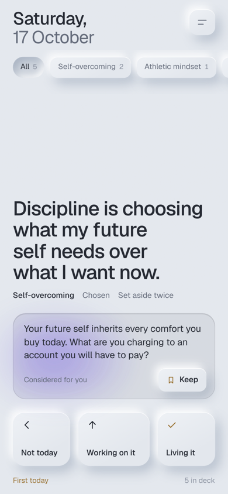

# Scales

A small phone app for turning the principles you collect into how you actually live.

You write down a principle you want to live by ("the hard conversation is usually shorter than the dread before it"), or load a starter deck. Scales keeps putting it in front of you. Each time, you mark it Testing it, Not today, or Living it. Once you act on it without being reminded, it moves to your Living it record with a line on where it showed up.

<p>
  
  
  
</p>

## How it works

**The deck.** One principle on screen at a time. Three moves:

| Move | Gesture or key | What happens |
|---|---|---|
| Not today | swipe left | Its count goes up by 1. The principle rests, then comes back more often. |
| Testing it | swipe up | Counts as an inspection. If you stayed on the card at least 8 seconds, the not today count drops by 1. |
| Living it | swipe right | Opens a short form for where it showed up, then moves the principle to your record. |

The same three moves are three keys under the principle, always on screen, and the arrow keys (left, up, right). Swipe anywhere on the deck; the key for the move you are heading toward presses in as you drag. Everything else (Capture, Edit, the Ledger, Collections, Settings) is in the menu at the top right. With a keyboard, N captures, E edits, L switches between the deck and the Ledger, M opens the menu, and comma opens Settings.

**Editing.** Press and hold the principle, choose Edit this principle in the menu (or press E), or Edit on any Ledger row, to change a principle's wording or its details: collection, title, author and where it came from. Its counts, dates and weight are kept. Changing the wording of a principle still in the deck gets it a fresh AI line; changing only details keeps the line it has. A lived principle keeps its Living it date, evidence and last line either way. Principles can be up to 1,500 characters, long enough for a short poem. The Capture sheet has the same details under More details, collapsed by default.

**Where it came from.** Under each principle: its collection, where it came from, its author, and how often it has been set aside. Settings > Look > Show where it came from turns off the collection, origin and author.

**Collections.** A collection groups principles, such as Poems or Stoic. Typing a collection that matches an existing one apart from capitalization saves it under the existing spelling, so collections don't split. Settings > Manage collections lists every collection with its count; tap one to rename it, merge it into another by renaming it to that name, or remove it. Only the collection changes; everything else on each principle is kept.

**Rest and the front of the stack.** Not today sets a principle aside for four days by default, so a reflex skip each morning can't become a habit. Settings > Deck > Rest after Not today changes it, from 1 to 7 days, starting with the next Not today. A Scales day runs from 4:00 AM to 4:00 AM, so a late-night session counts as the day it started in. On the morning it returns, every principle set aside since its last turn comes up first, once each: most avoided first, then the one waiting longest. After its turn it rejoins the weighted draw. If everything is resting, the deck says Nothing left today and when the next principle returns, with Show anyway to bring resting principles back until the day ends. Show on a Ledger row opens that principle on the deck, even while it rests.

**Today's set and today's focus.** Each day starts with a set of principles, five by default (Settings > Deck > Today's set, 1 to 20); dots at the top show how far along you are. When the set is done, the deck says Done for today, sums up how it went, and asks which one you will act on today. That one becomes **today's focus** and stays on screen. Keep going opens the deck again if you want more. Every third time you choose Testing it, Scales asks for the smallest act you can take today, and that act appears with today's focus.

**Evening check-in and Caught it.** From 6 PM until the day ends at 4:00 AM, Scales opens on one question about today's focus: did you live it today? Not today, Partly, or Yes. Yes asks where it showed up and logs it as **Caught it**, real-life evidence that you lived the principle without the app. You can also log a catch any time from the menu (Caught it) or from a principle in the Ledger. Three catches within 30 days ask whether you are ready to call it Living it.

**Your week.** On Sunday, Scales opens a short review of the last seven days: how many principles you weighed, how many times you caught yourself, what you now live, and what pushed back most, with one voice weighing in on the week if you ask. It is in the Ledger any day.

**Daily reminder.** Scales has no server, so it cannot send notifications. Settings > Daily reminder walks through an iPhone Shortcuts automation that opens Scales at a time you choose, once for the morning set and once for the evening check-in.

**Weighting.** What you set aside comes back more often. A principle's chance of showing up is `1 + 0.5 x not today count`, capped at 4x. A short cooldown keeps the same principle from repeating back to back.

**Pushing back.** The In deck list puts the principles you set aside most at the top, and Your week names the one that pushed back most, so resistance is visible instead of hidden.

**Undo and the first card.** Not today, Testing it, Living it and Delete each show a toast with Undo for 5 seconds that puts everything back, counts, rest days, the activity grid and the Ledger included. The first card anyone sees shows the three moves in a small panel; it is dismissed by Got it, a tap outside it, or the first real move, and does not come back.

**Starter decks.** Stoic, Leadership, Athletic mindset and Self-overcoming sets, loaded from Settings or the empty deck, so a new deck has something in it. Every starter principle fills every field (collection, title, author, origin, tags, link and citation) as a worked example. Original lines are credited to Scales and cite their deck. The lines by Epictetus and Nietzsche use the exact wording of a named public-domain translation (Elizabeth Carter, George Long, Thomas Common), cite the work and section, and link to that chapter. Loading a deck again adds nothing new; it fills any empty fields on starter principles already in the deck without overwriting your own values.

**The ledger.** A record, not a scorecard: one sentence on where you stand, Your week, a 12 week grid of days (brighter on busier days, brass on days you caught yourself or marked Living it), and the In deck and Living it lists. Tap a principle for its history (set aside, smallest acts, catches, talks, wording changes, Living it) and everything you can do with it. The Living it list is the record: each principle in full, the last model line it received, and where it showed up, editable later. The Living it and evidence sheets show that last line too, so it is in view while you write.

**The line under each principle.** A short line, 25 words or fewer, drawn from the words of the principle itself and written in the spirit of Jung and Nietzsche: avoidance is treated as the shadow protecting comfort, fear or self-image, and the line speaks for the person you are becoming rather than your comfort today. It holds the standard. No praise, no pep talk, and no grace for the gap between the principle and your conduct. It presses harder the more a principle has been set aside: fresh ones are asked what they demand, set-aside ones what was chosen instead, and the most avoided are confronted with what the avoidance protects. Lines that slip into a gentle, permission-giving tone are rejected and asked for again. Built-in questions are used by default. If you add your own Anthropic API key in Settings, a new consideration is written for each showing by a small, fast model. Only the principle text, its not today count and days in the deck are sent. Settings > AI lines can switch model lines off while keeping the key.

**Keep an AI line.** Sometimes the line says it better than you did. Tap **Keep** on an AI line (on the deck, or Keep line in the Living it record) and choose:

- **Add as a new principle.** It goes into the same collection beside the original, with fresh counts, cited as "Kept from an AI line" with the date and linked to the original. No author is set.
- **Replace my wording.** It works like Edit: counts, dates and status stay, and only the words change. The earlier wording is saved and shown in the Ledger.

Either one can be undone from the toast. Built-in questions have no Keep, since they are the same for every principle.

**A thinker weighs in.** After a move, **Weigh in** appears under the keys. Tap it and today's voice gives one line on the move you just made: whether Not today was honest or evasive, whether Living it was earned. The voices are Carl Jung, Friedrich Nietzsche, Fyodor Dostoevsky, Epictetus, Marcus Aurelius, Esther Perel, Jordan Peterson and David Goggins, plus anyone you add in Settings > Voices. One voice weighs in each day, in turn, changing at 4:00 AM.

The point is perspective, not quotation. The model reasons from each thinker's known ideas; nothing is copied from their writing, and every line is labeled as written by AI. Thinkers who have died speak in the first person ("In the spirit of Nietzsche"). Living people are written about in the third person ("Through Goggins's lens"), never voiced; a name you add is treated as living unless you mark it otherwise. The same checks as the AI line apply: short, no exclamation marks, nothing that softens the standard. **Keep** works on these lines too.

**Talk it through.** From the Weigh in sheet you can answer back, up to six replies, and the voice presses on your reasoning. The exchange is saved on the principle; **Talk** on its Ledger row opens it again, where it can be deleted. Weigh in and Talk it through need an API key and send only the principle, the move, its counts and the exchange itself.

## Origin

The name comes from scales falling from the eyes, and from Nietzsche's three metamorphoses: the camel carries ideas, the lion tests them, the child acts from them without thinking. Scales is built for the lion stage.

## Privacy

- Everything lives in the phone's browser storage. No account, no server, no analytics.
- The API key, if used, stays on the phone and is sent only to `api.anthropic.com`.
- Starter decks are written for this app and contain no personal data.

### About the API key

The key is stored in the browser's local storage and sent directly from the phone, using Anthropic's header for browser access. That is a reasonable trade for a personal app with no server, but it has limits worth knowing:

- Anyone with the unlocked phone can read the key from Settings.
- Any script that ran on this page could read it. The app loads no third-party scripts and escapes all user text before display, which keeps that risk low, but it is not zero.

So use a key made only for Scales, and in the Anthropic Console give its workspace a low monthly spend limit (a few dollars covers heavy daily use with a small model). If the phone is lost, revoke the key in the Console. Removing it in Settings only clears it from this phone.
- CSV and JSON files are ignored by git (`.gitignore`) so a personal export never ends up in this repo.

## Install on an iPhone

1. Open `https://grahamdeno.github.io/scales/` in Safari.
2. Share > Add to Home Screen.
3. Open it from the home screen icon. It runs full screen and works offline.

Optional: menu (top right) > Settings > AI lines > paste an Anthropic API key > Save key. See [About the API key](#about-the-api-key) first.

To check the key, tap **Test key** under AI lines. It sends one tiny request and reports the result in plain terms: working, key not recognized, no credit on the account, rate or spend limit reached, or no connection.

## Your data

- **Back up / Restore** (Settings): a JSON file of the whole deck. Keep it in iCloud Drive. Restore merges, it does not overwrite.
- **Import / Export CSV** (Settings): columns `text,title,author,creationDate,tags,collection,link,citation`, which matches common highlight and quote exports. Export adds `scales_*` columns (status, skips, reflects, shed date, evidence, last model line) so a re-import keeps progress. Import leaves out principles already in the deck. Internal field names (`shed`, `skips`) are unchanged so older exports still import.
- Deleting the home screen icon deletes the data. Back up first.

## The look

**Matte (1.30.0).** A matte, lightly grained ground in two looks, Matte (dark, the default) and Light, chosen in Settings > Look. Two materials sit on it: raised, for anything you press (the three keys, the collection keys, buttons), and pressed, for fields, wells, and the choice that is selected. Frosted glass is kept for what floats over the page: the AI line, the menu, sheets and the toast. Brass marks Living it and the one primary action on each sheet; a soft violet light sits behind the AI line, the one lit element on the page. One face, Geist, self-hosted so it looks the same offline.

The principle is not on a card: its words sit on the page above the AI line and the three keys. As you swipe, the words lean a little, the key for the move presses in, and a small label names the move. Let go early and they spring back; Living it ends with a short ring of brass. With Reduce Motion on, the springs, the ring and the view transitions are left out.

Earlier looks: 1.27.0 put the principle on a tilting card with a frosted tab bar; 1.28.0 and 1.29.0 followed a serif, front-page system with a single corner button and six color themes. 1.30.0 replaced both. A theme chosen under 1.29.0 is dropped, and the app opens in Matte.

## Project layout

```
index.html              the app: markup, styles, UI script
core.js                 pure logic: weighting, selection, answer checks, version
sw.js                   service worker: offline shell, network first
fonts/                  Geist (woff2, latin) and its license (OFL)
manifest.webmanifest    home screen name, colors, icons
icons/                  app icon, maskable icon, favicons, source SVG
tests/                  node:test suite for core.js and release wiring
docs/                   architecture diagrams and screenshots
```

See [docs/ARCHITECTURE.md](docs/ARCHITECTURE.md) for diagrams of how the pieces fit, how a principle moves from capture to Living it, and what happens each time a card is shown.

No build step and no runtime dependencies. The type face is served from `fonts/`; the only outside request is the Anthropic API, and only if a key is set.

## Design decisions

- **One page, one logic file.** The UI lives in `index.html`. The parts worth testing (weighting, selection, answer checks) live in `core.js`, which the page loads with a plain script tag and the tests load with `require()`. Still nothing to build or install.
- **Network first service worker.** Updates show up the next time the app opens; the cache only covers being offline. API calls are never cached.
- **Built-in questions as the floor.** The app is fully usable with no key and no connection. With a key, the next card's line is fetched while the current card is read, and a built-in line is shown only if the model cannot supply a valid one (25 words or fewer after trimming to whole sentences, no exclamation mark, not a restatement of a long principle).
- **Not today cap at 4x.** Without a cap, one avoided principle would take over the deck.
- **Dwell check on Testing it.** A quick swipe up should not erase a Not today. Eight seconds on the card is the bar.

## Run it locally

```sh
python3 -m http.server 8000
```

Then open `http://localhost:8000`. The service worker needs `localhost` or HTTPS.

## Tests

```sh
node --test
```

Node 18 or later, no dependencies. Covers weighting, the selection cooldown, answer cleanup and checks, and the version and offline-cache wiring. GitHub Actions runs the same command on every push.

## Versioning

Releases are numbered `MAJOR.MINOR.PATCH`:

| Part | When it changes | Example |
|---|---|---|
| Major | Breaking changes, such as a stored-data change that needs migration | 1.21.0 to 2.0.0 |
| Minor | New features and enhancements. Patch resets to 0. | 1.21.0 to 1.22.0 |
| Patch | Defect fixes only | 1.21.0 to 1.21.1 |

Every release, patches included, gets a new version number. GitHub Actions adds the matching git tag (`v1.21.0`) automatically after the tests pass.

## Updating the live app

1. Set `VERSION` (and `BUILT`) in `core.js` and the matching `CACHE` name in `sw.js` (`scales-v1.21.0`). The tests fail if they differ or if the version is not three numbers.
2. Run `node --test`.
3. Push to `main`. GitHub Pages redeploys in about a minute, and once the tests pass, GitHub Actions tags the commit with the new version (`v1.21.0`).
4. On the phone, close and reopen Scales, then check Settings > About for the new version number.

## Roadmap

- iOS home screen widget showing the current principle
- Action Button shortcut for Not today and Testing it
- Whoop recovery as context for when to show the harder principles (kept on device, never sent to the model)

## License

MIT. See [LICENSE](LICENSE).
