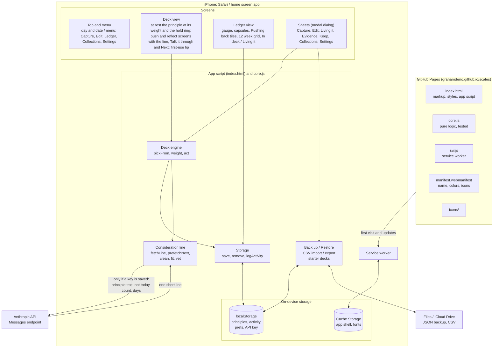
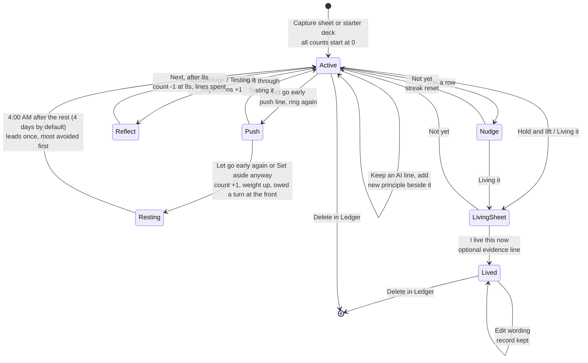

# Scales architecture

Scales is a single page app with no build step and no backend. Everything the app does happens on the phone. The only outside services are GitHub Pages (hosting) and, if a key is saved, the Anthropic API. The type face (Geist) ships in `fonts/`.

The user-facing names (principle, Not today, Testing it, Living it) differ from some internal names, which were kept so stored data and exports stay compatible:

| On screen | In code and storage |
|---|---|
| Principle | thought (`thoughts`, `scales.thoughts.v1`) |
| Not today | skip (`skip_count`, `lifetime_skips`) |
| Testing it | keep / reflect (`reflect_count`) |
| Living it | shed (`status: "shed"`, `shed_at`, `evidence`) |

## Where everything sits



## A principle from capture to Living it



## One principle on screen

```mermaid
sequenceDiagram
    actor U as User
    participant D as Deck engine
    participant L as Consideration line
    participant S as localStorage
    participant A as Anthropic API

    D->>D: show queued principle, or pickFrom() weighted with cooldown
    D-->>U: the principle and the ring, nothing else
    D->>L: requestLine(principle)
    L->>A: write the push and reflect lines if missing or stale (lineFresh), and the next principle's
    A-->>L: short lines, vetted, kept on the principle (keepLine)
    U->>D: hold the ring and let go
    alt let go early
        D-->>U: push screen: push line, ring again (built-in line if none kept and no key)
        U->>D: hold through, or let go early again / Set aside anyway
    else hold through
        D-->>U: reflect screen: reflect line, Talk it through; Next after 8s
        U->>D: Next
        D->>S: count -1 at 8s, lines spent (spendLines)
    end
    D->>S: save counts, log today's activity
    D->>D: show the queued principle
```

## Storage keys

| Key | Holds |
|---|---|
| `scales.thoughts.v1` | Every principle by id: text, `lines` (push and reflect, each with the wording and Not today count it was written for), collection, title, author, origin, dates, status, counts, recent lines, evidence; for a kept AI line, `kept_from` and `kept_at`; for a replaced wording, `earlier` (last five) and `worded_from_ai`; `talks` (last five weigh-ins, each with its voice, move, line and replies); `acts` (smallest acts by day), `caught` (Caught it by day), `checkins`, `skips_on` (days set aside, for the weekly review) |
| `scales.activity.v1` | Per Scales day counts: `i` weighed, `s` Living it, `c` Caught it; last 120 days |
| `scales.prefs.v1` | Today's set (`day`: moves, focus, check-in), set size, the Testing it count, the week's review state, look, rest length, Show where it came from, AI lines on or off, chosen voices and names added, the collection key, Show anyway's day, first-use tip seen |
| `scales.apikey.v1` | Anthropic API key, only if saved |

## Key numbers

| Setting | Value | Why |
|---|---|---|
| Weight | 1 + 0.5 per Not today | Avoided principles come back more often |
| Weight cap | 4x | One principle cannot take over the deck |
| Day boundary | 4:00 AM local | A late-night session counts as the day it started in |
| Rest after Not today | 4 days (`REST_DAYS`), 1 to 7 in Settings (`restDays`) | Long enough that a reflex skip each morning cannot become a habit; was 1 day in 1.24.0 |
| Talk it through | 6 replies, 70 words each | A reflection, not a chat |
| Today's set | 5 by default, 1 to 20 | Long enough to think, short enough to finish |
| Evening check-in | from 6 PM until 4:00 AM | After the day's chances to act |
| Smallest act | every third Testing it | Often enough to matter, rare enough not to nag |
| Caught it suggests Living it | 3 catches in 30 days | A pattern, not a single good day |
| Voices | one per Scales day, in turn | Each voice gets its day; the order is the list order |
| Press and hold to edit | 550 ms | Longer than a tap, shorter than a deliberate wait |
| Front of the stack | once per Not today | Most avoided first, then longest waiting since last shown |
| Cooldown | last 3 shown (last 1 in a deck of 3 or fewer) | No back to back repeats |
| Reflect (`REFLECT_SEC`) | 8 seconds before Next | A quick Testing it does not erase a Not today; the wait is visible as a filling line |
| Pushback | once per showing | A second early release sets it aside; a second warning would nag |
| Lines (`lineFresh`) | kept per principle, rewritten after a test, a wording change, or once at 3 Not today | Reused for cost and consistency, refreshed so the pushback does not go stale |
| Nudge | 3 Testing it in a row | Prompts the Living it question |
| Line length | 25 words | Room for one complete consideration, still readable at a glance |
| Model output budget | 1024 tokens | The model may reason before answering, and reasoning counts against the budget |
| Hold through (`HOLD_FULL`) | 2.4 seconds | Long enough to read a short principle as it inks in |
| Tap (`HOLD_TAP`) | under 0.3 seconds does nothing | A stray touch never rests a principle for days |
| Lift (`HOLD_LIFT`) | 70 px up | Clear of a thumb's wobble while holding |
| Type weight (`inkWeight`) | 400, plus 125 per Not today, to 900 | Avoidance shows in the words themselves |
| Ledger groups (`ledgerGroup`) | Avoiding at 3 or more Not today; Nearly lived at 0 with 3 tests, 2 in a row, or a catch | Three groups a glance can read |
| Principle length | 1,500 characters | Capture and Edit share the limit; long enough for a short poem |
| Collection, title, author | 40, 120, 80 characters | Enough for a name; collections match existing ones ignoring capitalization |

## Versioning and updates

`core.js` holds `VERSION` as `MAJOR.MINOR.PATCH` (major for breaking changes, minor for features and enhancements, patch for defect fixes only), shown in Settings under About. The service worker cache is named `scales-v` plus the same version, and tests fail if the two differ or the version is not three numbers. Change both on every release so installed phones drop the old cache, and so the number in Settings confirms which build is running. GitHub Actions tags each release in git as `v` plus the version once the tests pass. The service worker fetches same-origin files with `cache: "no-cache"`, so a new release is picked up on the next launch rather than after GitHub Pages' ten minute cache lifetime.

## Page sizing on iPhone

`html` is `height:100%; min-height:100lvh` and `body` is `height:100dvh; overflow:hidden`. This is the combination confirmed to fill the display from the Home Screen. Clipping `html` to the viewport (1.22.1) or pinning `body` with `position:fixed` (1.22.2) both left the app about one status bar short of the bottom in Home Screen mode, which a desktop browser emulating a phone does not reproduce. Page offsets left by the keyboard, and Safari's scroll memory, are handled in script instead (`resetScroll`). Measured on an iPhone from the Home Screen with 1.22.3: screen 874, window 874, visible 874, app 0 to 874, dvh 874, svh 812, lvh 874, safe area 62 top and 34 bottom. The short value, 812, is the screen minus the 62 point status bar area; both broken releases ended up sized to it, which is why each left a gap exactly the status bar's height. Settings > About shows a screen check (screen, window and visible heights, the app's top and bottom, dvh/svh/lvh, safe areas, scroll offset) so any change here can be checked against real phone numbers.

## Tests

`node --test` runs `tests/core.test.js` with no dependencies. It covers weighting, the selection cooldown, answer cleanup and checks (including the short-principle case that once discarded every model line), rest and the front of the stack, undo, collections, keeping an AI line, the hold and Ledger groups, the page wiring for the Black and White design, and the version and offline-cache wiring. GitHub Actions runs the same command on every push to `main`.

## Design system (1.33.0, Black and White; quiet deck 1.34.0)

Colors are custom properties on `:root`, with a second set under `:root[data-look="light"]` (stored as `look: "light"`, shown as White; the default is shown as Black): `--paper` (ground), `--deep` (a field or the selected choice), `--ink`, `--muted`, `--faint`, `--rest` (words not yet inked), `--line` (hairlines), `--danger`. `--brass`, `--violet` and `--onBrass` remain as aliases of ink and paper so older markup reads correctly. Corners are square (`--r-*` are 0). There are no shadows, gradients or backdrop blur.

| Class | Now | Used for |
|---|---|---|
| `.raised` | hairline box | buttons and options that need an edge |
| `.pressed`, `.raised[aria-pressed="true"]` | deeper fill, ink edge | the selected choice |
| `.glass` | plain, no surface | the AI line, the first-use tip, AI lines in sheets |
| `.frost` | ground with a hairline | the menu |
| `.primary` | solid ink | one per sheet |

The deck's words are one `<span class="w">` each (`wordsHtml`), so the hold can ink them in turn (`.thought.ink .w.in`). The ring (`#holdRing`) is pointer only and hidden from assistive tech; the three buttons (`data-move`, visually hidden until focused) are the accessible path. The deck has three stages (`phase`): rest, push and reflect; a principle mid-push or mid-reflect stays on screen even when that move ended the day's set.
