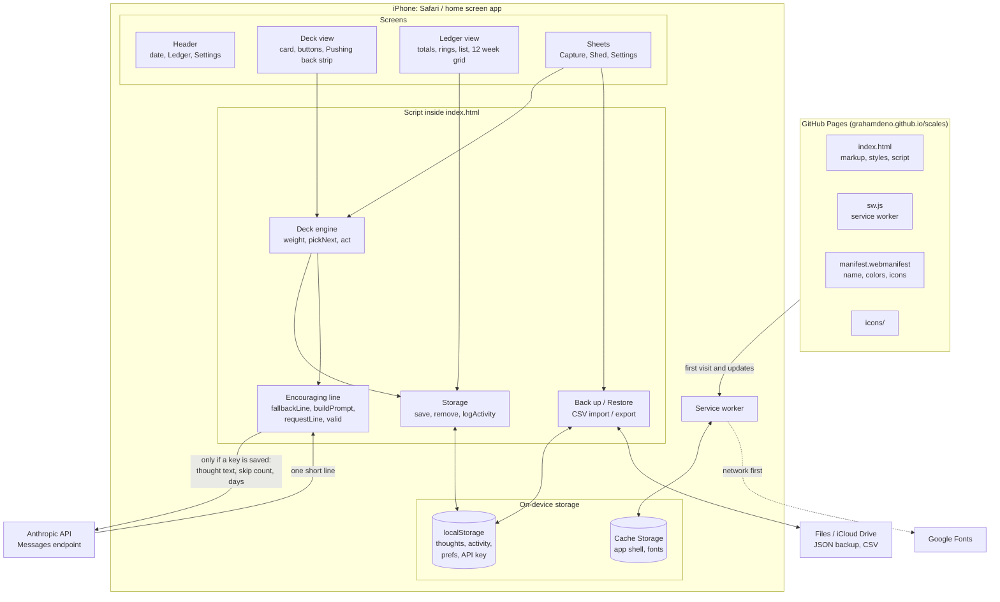
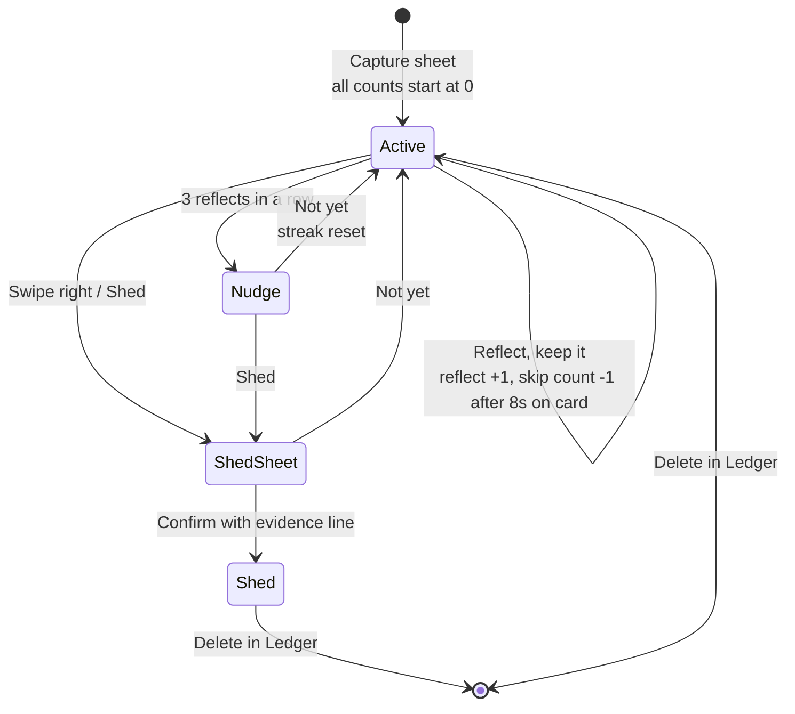
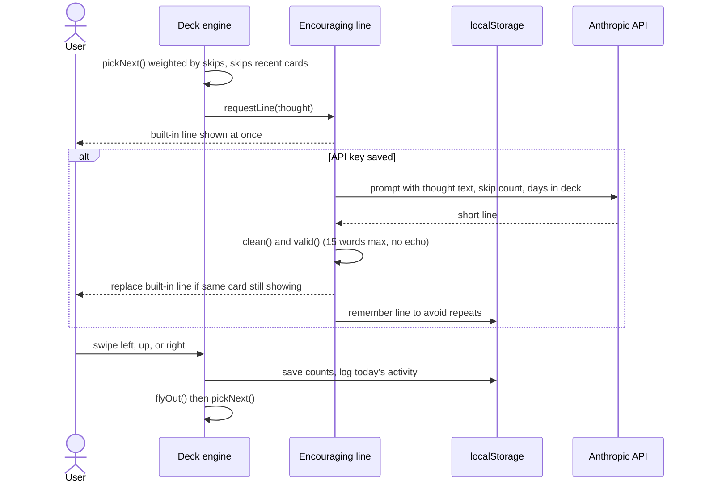

# Scales architecture

Scales is a single page app with no build step and no backend. Everything the app does happens on the phone. The only outside services are GitHub Pages (hosting), Google Fonts, and, if a key is saved, the Anthropic API.

## Where everything sits

## A thought from capture to shed

## One card on screen

## Storage keys

| Key | Holds |
|---|---|
| `scales.thoughts.v1` | Every thought by id: text, origin, dates, status, skip and reflect counts, recent lines, evidence |
| `scales.activity.v1` | Per day counts of inspections and sheds, last 120 days |
| `scales.prefs.v1` | Theme choice |
| `scales.apikey.v1` | Anthropic API key, only if saved |

## Key numbers

| Setting | Value | Why |
|---|---|---|
| Weight | 1 + 0.5 per skip | Avoided thoughts come back more often |
| Weight cap | 4x | One thought cannot take over the deck |
| Dwell check | 8 seconds | A quick swipe up does not erase a skip |
| Nudge | 3 reflects in a row | Prompts the shed question |
| Line length | 15 words | Short enough to read at a glance |
| Swipe threshold | 90 px | Short drags spring back |
