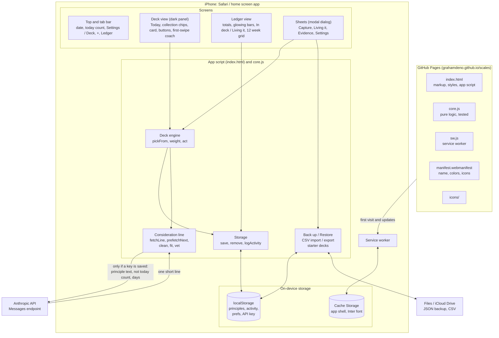
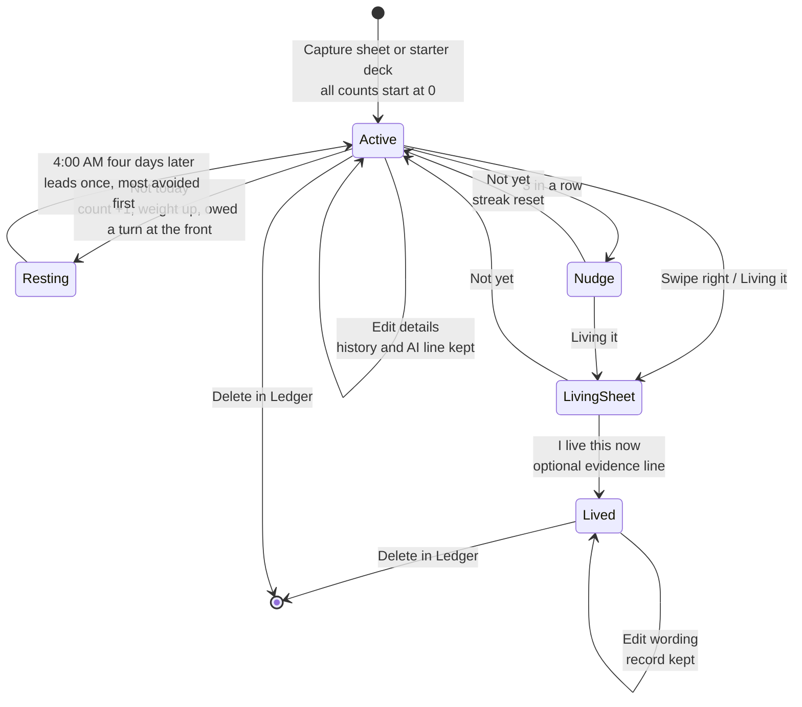
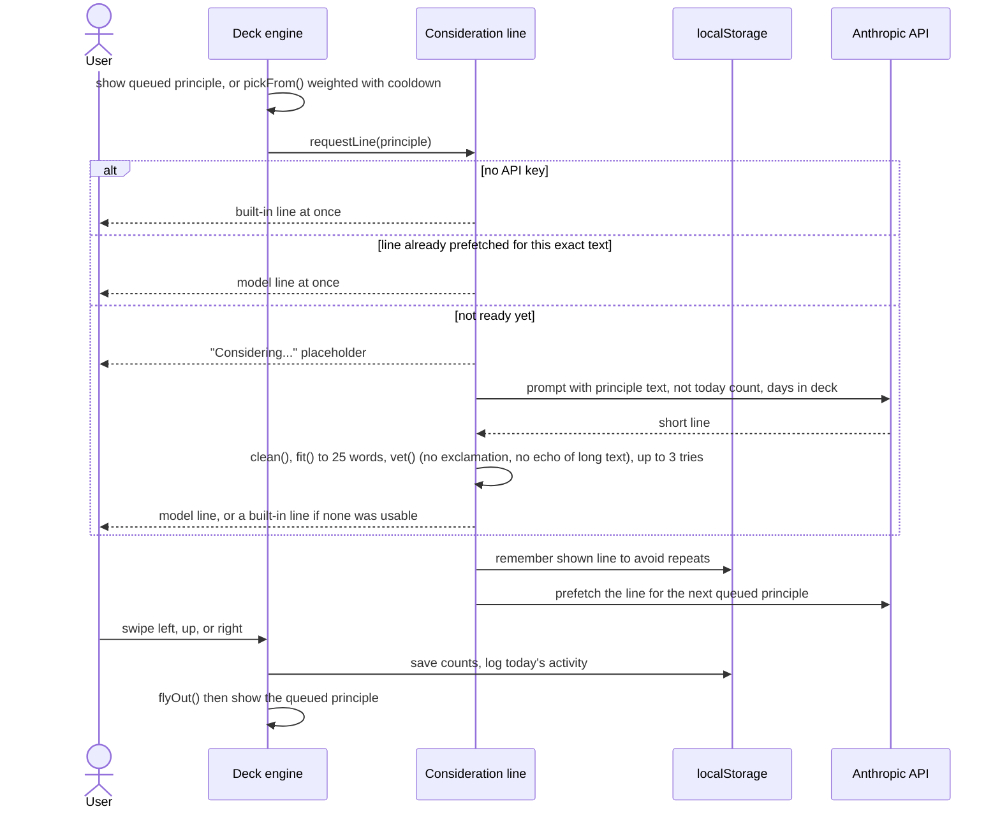

# Scales architecture

Scales is a single page app with no build step and no backend. Everything the app does happens on the phone. The only outside services are GitHub Pages (hosting) and, if a key is saved, the Anthropic API. The type face (Inter) ships in `fonts/`.

The user-facing names (principle, Not today, Still working on it, Living it) differ from some internal names, which were kept so stored data and exports stay compatible:

| On screen | In code and storage |
|---|---|
| Principle | thought (`thoughts`, `scales.thoughts.v1`) |
| Not today | skip (`skip_count`, `lifetime_skips`) |
| Still working on it | keep / reflect (`reflect_count`) |
| Living it | shed (`status: "shed"`, `shed_at`, `evidence`) |

## Where everything sits

## A principle from capture to Living it

## One card on screen

## Storage keys

| Key | Holds |
|---|---|
| `scales.thoughts.v1` | Every principle by id: text, collection, title, author, origin, dates, status, counts, recent lines, evidence |
| `scales.activity.v1` | Per day counts of inspections and Living it, last 120 days |
| `scales.prefs.v1` | Theme choice |
| `scales.apikey.v1` | Anthropic API key, only if saved |

## Key numbers

| Setting | Value | Why |
|---|---|---|
| Weight | 1 + 0.5 per Not today | Avoided principles come back more often |
| Weight cap | 4x | One principle cannot take over the deck |
| Day boundary | 4:00 AM local | A late-night session counts as the day it started in |
| Rest after Not today | 4 days (`REST_DAYS`) | Long enough that a reflex skip each morning cannot become a habit; was 1 day in 1.24.0 |
| Front of the stack | once per Not today | Most avoided first, then longest waiting since last shown |
| Cooldown | last 3 shown (last 1 in a deck of 3 or fewer) | No back to back repeats |
| Dwell check | 8 seconds | A quick swipe up does not erase a Not today |
| Nudge | 3 Still working on it in a row | Prompts the Living it question |
| Line length | 25 words | Room for one complete consideration, still readable at a glance |
| Model output budget | 1024 tokens | The model may reason before answering, and reasoning counts against the budget |
| Swipe threshold | 90 px | Short drags spring back |
| Principle length | 1,500 characters | Capture and Edit share the limit; long enough for a short poem |
| Collection, title, author | 40, 120, 80 characters | Enough for a name; collections match existing ones ignoring capitalization |

## Versioning and updates

`core.js` holds `VERSION` as `MAJOR.MINOR.PATCH` (major for breaking changes, minor for features and enhancements, patch for defect fixes only), shown in Settings under About. The service worker cache is named `scales-v` plus the same version, and tests fail if the two differ or the version is not three numbers. Change both on every release so installed phones drop the old cache, and so the number in Settings confirms which build is running. GitHub Actions tags each release in git as `v` plus the version once the tests pass. The service worker fetches same-origin files with `cache: "no-cache"`, so a new release is picked up on the next launch rather than after GitHub Pages' ten minute cache lifetime.

## Page sizing on iPhone

`html` is `height:100%; min-height:100lvh` and `body` is `height:100dvh; overflow:hidden`. This is the combination confirmed to fill the display from the Home Screen. Clipping `html` to the viewport (1.22.1) or pinning `body` with `position:fixed` (1.22.2) both left the app about one status bar short of the bottom in Home Screen mode, which a desktop browser emulating a phone does not reproduce. Page offsets left by the keyboard, and Safari's scroll memory, are handled in script instead (`resetScroll`). Measured on an iPhone from the Home Screen with 1.22.3: screen 874, window 874, visible 874, app 0 to 874, dvh 874, svh 812, lvh 874, safe area 62 top and 34 bottom. The short value, 812, is the screen minus the 62 point status bar area; both broken releases ended up sized to it, which is why each left a gap exactly the status bar's height. Settings > About shows a screen check (screen, window and visible heights, the app's top and bottom, dvh/svh/lvh, safe areas, scroll offset) so any change here can be checked against real phone numbers.

## Tests

`node --test` runs `tests/core.test.js` with no dependencies. It covers weighting, the selection cooldown, answer cleanup and checks (including the short-principle case that once discarded every model line), and the version and offline-cache wiring. GitHub Actions runs the same command on every push to `main`.
